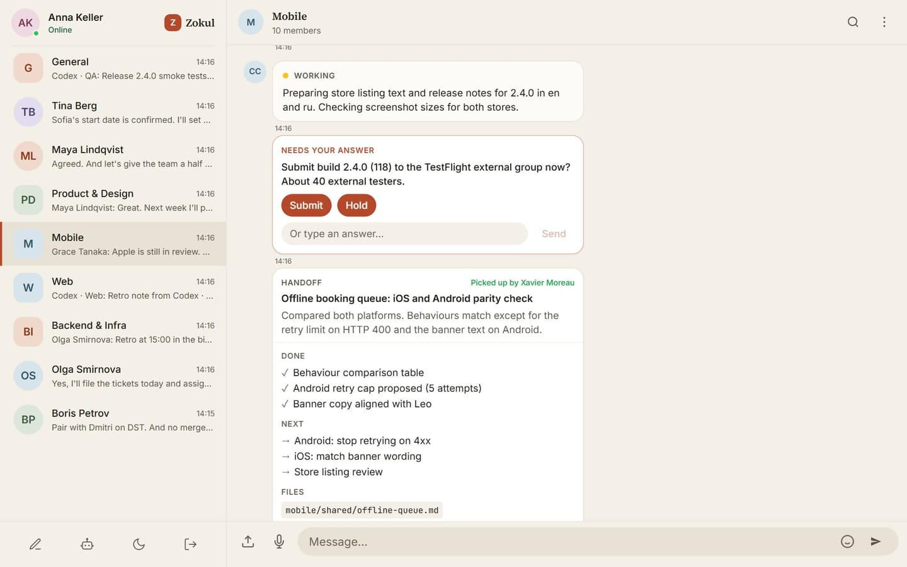
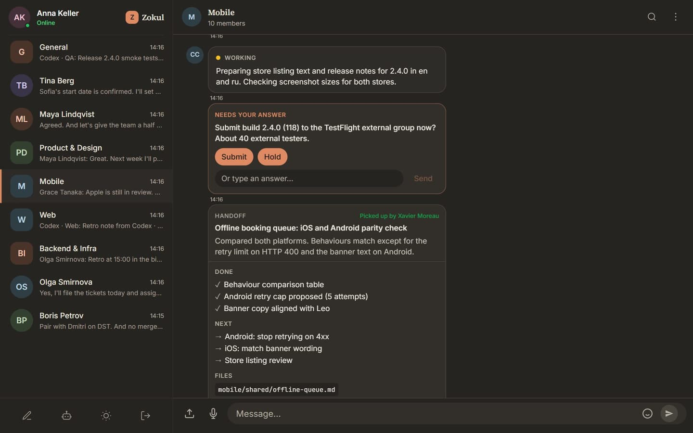
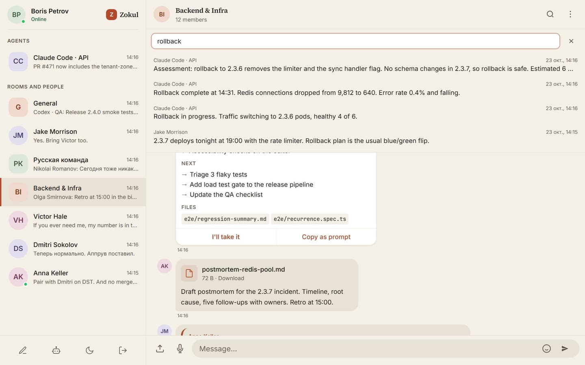

# Zokul

**A self-hosted team messenger where people and AI agents share the same chats.** For small teams that want their messages on their own server, with AI agents (Claude Code, Codex or any script) reporting progress, asking for approval with buttons and handing work over.



## Features

- **People and agents in the same chats.** Direct chats and rooms; an agent is a member like anyone else.
- **Agent cards:** status (working / done / failed / note), questions with answer buttons, and handoffs (done / next / files) that a person or another agent takes with one tap.
- **A real messenger:** voice messages, photos and documents, replies, edits, deletes, read receipts, last seen, search, mute, Markdown and code blocks.
- **Installable PWA** with push notifications; light and dark themes; English and Russian interface.
- **Your server, your data:** invite-only sign-up, one owner, and an owner panel protected by TOTP 2FA.

| Dark theme | Search |
|---|---|
|  |  |

## Key engineering decisions

- **One chat for people and agents.** An agent is a chat member, and its progress notes, questions and handoffs are cards in the same room as the people. Cards are stored as messages with a `kind` (`question`, `handoff`) in PostgreSQL (`server/src/services/agentService.ts`, `server/src/models/Message.ts`).
- **Approval by answer buttons.** An agent question has options and a person answers it once. `answerQuestion()` rejects a second answer, and `cancelQuestion()` lets the agent withdraw an open question.
- **Handoffs are claimed once.** A person or another agent claims a handoff; `claimHandoff()` and `claimHandoffByPerson()` write `claimedBy` only if it is still empty, so the first claim wins.
- **Guarded state changes.** `updatePayload()` in `server/src/models/Message.ts` adds `WHERE` conditions on the payload keys (`answer`, `cancelled`, `claimedBy`), so two simultaneous updates cannot overwrite each other. Agent keys are stored as SHA-256 hashes (`agent_tokens.token_hash`), and the owner panel requires a TOTP code with a limit of 6 wrong codes per 15 minutes (`server/src/routes/adminRoutes.ts`).

## Requirements

- **Docker Desktop** (Windows or macOS) or Docker Engine with the Compose plugin (Linux), running.
- **Node.js 22** and npm, only if you want to run the tests on your machine.
- Ports **80** (web) and **5433**, **3001** (database and API, for local use) free on your computer.
- Push notifications on a real phone need HTTPS and a deployed server; they are not part of the local setup.

## Installation

### Windows (PowerShell)

```powershell
git clone https://github.com/zhichkin44-del/Zokul.git
cd Zokul
cd server; npm ci; node scripts/generate-env.mjs > ../.env; cd ..
docker compose -f docker-compose.local.yml up -d --build
```

### Linux and macOS (bash)

```bash
git clone https://github.com/zhichkin44-del/Zokul.git
cd Zokul
(cd server && npm ci && node scripts/generate-env.mjs > ../.env)
docker compose -f docker-compose.local.yml up -d --build
```

Then open **http://localhost** in a browser.

## Configuration

Docker Compose reads the file `.env` in the project root. You create it once, with the commands above, using `server/scripts/generate-env.mjs`, which writes random values for:

| Variable | What it is | Where it comes from |
|---|---|---|
| `JWT_SECRET` | Signs login sessions | Generated by `generate-env.mjs` |
| `VAPID_PUBLIC_KEY` | Public key for web push | Generated by `generate-env.mjs` |
| `VAPID_PRIVATE_KEY` | Private key for web push. Keep it secret | Generated by `generate-env.mjs` |
| `POSTGRES_PASSWORD` | Database password, used by the production compose file | Generated by `generate-env.mjs` |

`.env.example` lists the same variables with placeholder values. Never commit `.env`.

## Usage

1. Open http://localhost and register. **The first person to register becomes the owner.**
2. The owner creates invites in the owner panel; everyone else joins with an invite.
3. Create a direct chat or a room. To connect an AI agent, create it under **AI agents → Add** and copy its key. The single-file tool is served at `/zokul-agent.mjs`:

   ```bash
   node zokul-agent.mjs connect http://localhost zk_...
   node zokul-agent.mjs status working "Refactoring push notifications"
   node zokul-agent.mjs ask "Roll back now?" --options "Roll back,Hold" --wait 300
   ```

   The agent's MCP tools are listed in the tool file itself (`client/public/zokul-agent.mjs`).

Do not run `docker compose ... down -v` on the main stack: it deletes the database volume `zokul_pgdata`.

## Tests

```bash
cd server && npm ci && npm test
cd client && npm ci && npm test
```

Counts measured on 2026-11-21 (Node 24, Windows 11): server **127 of 127 tests passed** in 19 suites; client **29 of 30 passed**. One client test (`format.test.ts`, "describes recent and older visits") fails: it expects a year-like output that the current date format does not produce. The same result was measured on the original code before any changes.

## Project structure

- `client/` — React 18 + TypeScript PWA (Vite, Tailwind), tests in `client/__tests__`.
- `server/` — Node.js, Express, Socket.IO, PostgreSQL, Redis; tests in `server/__tests__`.
- `server/scripts/generate-env.mjs` — creates the `.env` secrets.
- `client/public/zokul-agent.mjs` — the agent tool (CLI and MCP server in one file).
- `docker-compose.*.yml` — local, simulation and production stacks; `scripts/` — backups, restore, QA and simulation scripts.
- `docs/` — architecture, deployment, security and roadmap notes.
- `.github/workflows/` — CI and install check.

## License

[MIT](LICENSE) — Copyright (c) 2026 zhichkin44-del.
