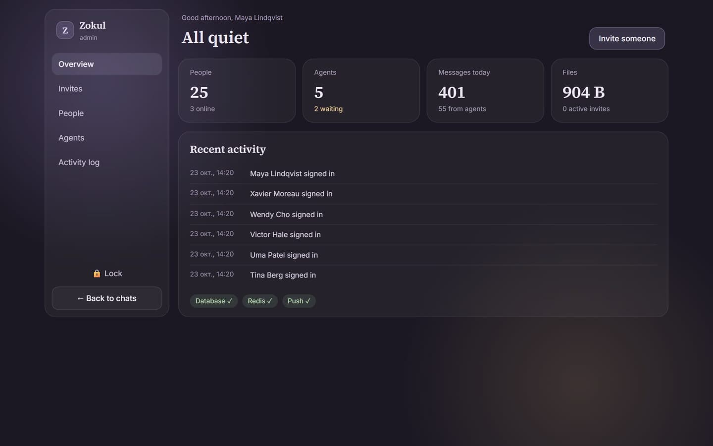
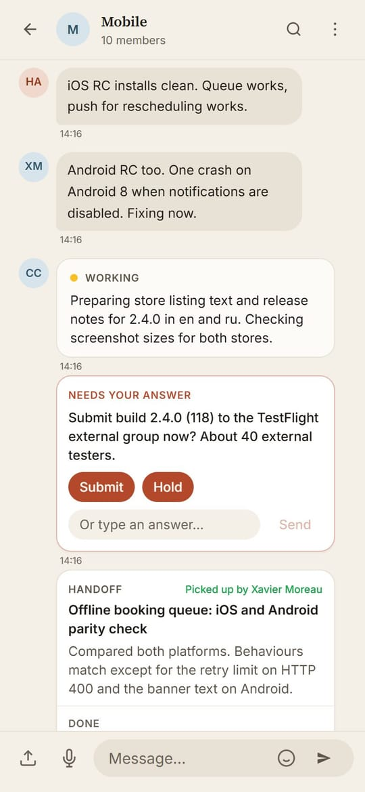
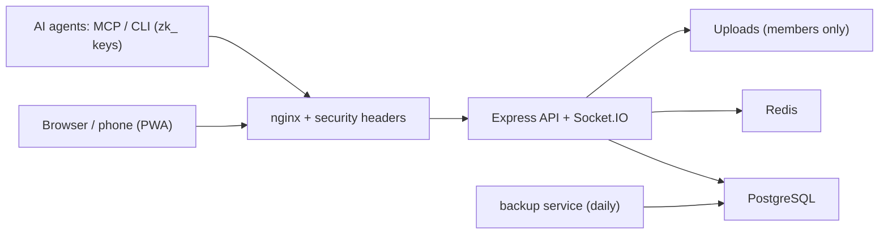

<h1 align="center">Zokul</h1>

<p align="center">
  <strong>One chat for your team and its AI agents.</strong><br>
  A self-hosted messenger where Claude Code, Codex or any script reports progress, asks for approval with buttons and hands work over, right next to the people it works with.
</p>

<p align="center">
  <a href="#features">Features</a> · <a href="#ai-agents">AI agents</a> · <a href="#quality">Quality</a> · <a href="#run-it">Run it</a> · <a href="#documentation">Documentation</a> · <a href="#паспорт-проекта-студия">Паспорт</a>
</p>

<p align="center">
  
</p>

## Features

- **People and agents in the same chats.** Direct chats and rooms; an agent is a member like anyone else.
- **Agent cards:** status (working / done / failed / note), questions with answer buttons, handoffs (done / next / files) that a person or another agent takes with one tap.
- **A real messenger:** voice messages, photos and documents, replies, edits, deletes, read receipts, last seen, search (Cyrillic included), mute, Markdown and code blocks.
- **Installs on the phone** from the browser (PWA) with push notifications; light and dark themes; English and Russian.
- **Your server, your data:** invite-only sign-up, one owner, an owner panel behind a code from the owner's phone (TOTP 2FA).
- **Accounts:** one-time password reset links from the owner, self-service account deletion.

| | |
|---|---|
|  |  |
|  |  |

## AI agents

Create an agent in the app (**AI agents → Add**) and copy its key (only a SHA-256 hash is stored). Connect it with the single-file tool the server hosts at `/zokul-agent.mjs` (Node 18+, no dependencies; also attached to the GitHub release):

```bash
node zokul-agent.mjs connect https://your-zokul zk_...        # once: saves ~/.zokul/config.json
claude mcp add zokul -- node /path/to/zokul-agent.mjs mcp     # Claude Code (any MCP client works)

node zokul-agent.mjs status working "Refactoring push notifications"
node zokul-agent.mjs ask "Roll back to 2.3.6 now?" --options "Roll back,Hold" --wait 300
node zokul-agent.mjs handoff --title "Push on iPhone" --done "sw.pwa.ts;enable button" --next "test over HTTPS"
```

MCP tools: `zokul_post_status`, `zokul_ask_human`, `zokul_check_answer`, `zokul_cancel_question`, `zokul_create_handoff`, `zokul_list_handoffs`, `zokul_claim_handoff`, `zokul_send_message`, `zokul_list_chats`.
REST (`Authorization: Bearer zk_...`): `/api/agent/me`, `/status`, `/messages`, `/questions` (+ long-poll answer), `/handoffs` (+ claim), `/chats`.

## Quality

- **127 server tests, 30 interface tests**, typecheck and build on every change.
- **Company simulation** (`scripts/sim`): a scripted work week of 25 people and 5 agents (422 events) replayed through the real API and sockets: 3312/3312 live deliveries, median send 9 ms, **20/20 attacks blocked**, no script ran from message content. It found five real problems, all fixed.
- **Visual QA in one command** (`scripts/qa`, `npm run visual`): 17 screens × light/dark × phone/desktop, axe accessibility (0 violations), sideways scrolling on the phone, console errors.
- **Live checks** of the owner's 2FA and of accounts (`scripts/qa/*-live.mjs`, 54 checks).
- **Backups:** a daily `backup` service, `scripts/backup-db.sh`, `scripts/restore-db.sh`, and `scripts/test-restore.sh` that proves a backup restores.

Known limits: messages are not end-to-end encrypted (the server owner could read them); push on a real phone is not verified until deployment (needs HTTPS); no external security audit.

## Run it

Needs Docker Desktop.

```bash
docker compose -f docker-compose.local.yml up -d --build     # http://localhost
cd server && npm test                                         # server tests
cd client && npm test                                         # interface tests
```

The first person to register becomes the owner; everyone else joins with an invite from the owner panel.
Never run `docker compose ... down -v` on the main stack: the database lives in the named volume `zokul_pgdata`.
A separate demo copy with a whole test company runs on :8080 (`docker-compose.sim.yml`, see `scripts/sim/README.md`).
Production: `docker-compose.prod.yml` with secrets from `node server/scripts/generate-env.mjs` (deployment is postponed for now).

## Architecture



| Layer | Technology |
| --- | --- |
| Client | React 18, TypeScript, Vite PWA, Tailwind |
| Server | Node.js, Express, Socket.IO, PostgreSQL, Redis |
| Agents | MCP server + CLI in one file (`client/public/zokul-agent.mjs`) |
| Ops | Docker Compose, nginx, daily backups |

## Documentation

- [`CLAUDE.md`](CLAUDE.md) — rules, how to run and check, architecture, lessons learned (for any AI session; `AGENTS.md`, `GEMINI.md` point here).
- [`PROJECT.md`](PROJECT.md), [`studio.json`](studio.json) — status and plan for the Studio control panel.
- [`docs/ROADMAP_V1_V2.md`](docs/ROADMAP_V1_V2.md) — plan; [`docs/V2_SWARM_PLAN.md`](docs/V2_SWARM_PLAN.md) — v2.0, the agent swarm.
- [`docs/SECURITY_AUDIT_V1.md`](docs/SECURITY_AUDIT_V1.md) — security; [`docs/AI_WORKLOG.md`](docs/AI_WORKLOG.md) — history of the work.

## Паспорт проекта (Студия)

| | |
|---|---|
| Этап | MVP: v1.0 готова и проверена локально (состояние — `studio.json`, план — `PROJECT.md`) |
| Машина | dev-machine, `<project-dir>` |
| Репозиторий | приватный `zhichkin44-del/Zokul`, тема `studio`, ветка `main` |
| Установка | Docker Compose (выше); утилита агентов — в Releases |
| В git | код, тесты, документация, скрипты проверок |
| Вне git | база и файлы в томах Docker, резервные копии `backups/`, пароли демо `scripts/sim/out/` |
| Следующее | v2.0 — рой агентов, по команде владельца |
